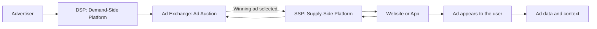
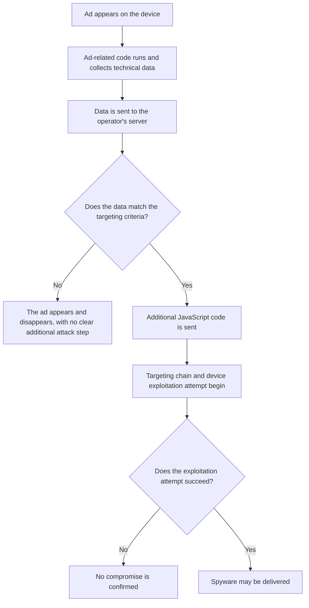
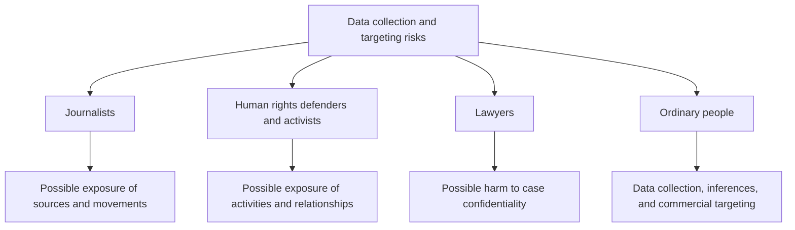
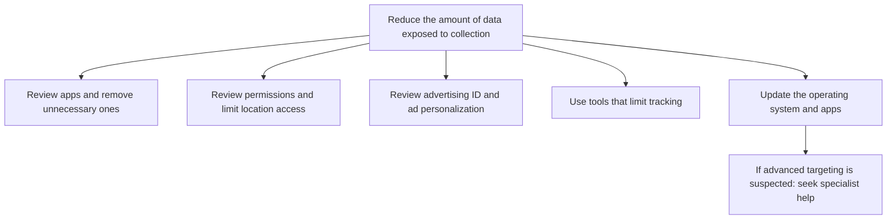

# AdFection: When an Ad Becomes a Gateway to Spying

Digital ads have become part of our everyday lives. We see them on almost every website and app. But behind the ad that appears on your phone screen, there is an entire system that handles your data and decides who gets to see what. In some cases, this system can turn from an advertising tool into a gateway for targeting devices and delivering spyware, even without the user clicking on the ad.

## Digital Advertising and the Use of Data

In the digital advertising ecosystem, the information collected about users is not always used simply to choose the right ad. And if this information falls into the wrong hands, it can harm you. For example, if someone finds out that a person has been searching for loans repeatedly, that person could be targeted with ads for loans that come with hidden fees, or even with scams and fraud campaigns built around their needs.

This information can also help someone target you with spyware. That is what was described in a Citizen Lab report about a technique they called AdFection. The report documented how the Israeli company Discover-Tech exploited the digital advertising infrastructure to help target devices with spyware linked to Candiru. The researchers linked the attacks, with a high degree of confidence, to operations that targeted devices on Al Jazeera's network. In this case, the ad was not just a way to display a product. It was used as a way to deliver spyware without the victim having to click on it.

### A simplified diagram of the digital advertising ecosystem

The diagram gives a general picture of how an ad opportunity moves between the advertiser, the platforms, and the website or app displaying it.

## Discover-Tech

In 2020, Dekel Boni founded Discover-Tech as a digital advertising and marketing company. Yaniv Basil and Guy Lants appeared among its shareholders in April of that year. Two months later, Eric Banoun joined its board of directors. The Israeli newspaper Haaretz described him as one of the pioneers of Israeli offensive cyber operations.

The company did not emerge out of nowhere. It benefited from the assets and expertise of earlier companies, such as Matomy, which launched the MyDSP technology in 2016 before selling it to Marketcom Technologies in 2018. Control of the main MyDSP domains later passed to Discover-Tech in 2020, although the exact details of that transfer remain unclear.

As for Controlium, it appeared as a tool or platform belonging to Discover-Tech. It allows users to set up advertising campaigns and control the targeting of specific devices or people using digital identifiers.

## How the Attack Worked

So how did all of this happen? We have explained how ads work, but how were they used for criminal purposes?

The ad has now appeared, and that is the first step. As we explained, it is not necessarily just an ordinary image. It may contain code that runs in the background and sends information about the person or device that saw the ad to a server operated by the party behind it. Based on its targeting criteria, that party decides whether the next step should happen.

For most people, the ad will appear and disappear without anything visibly happening. They may not even notice it. But when the data received matches the targeting criteria, the server may send additional JavaScript code that starts a chain of targeting and attempts to exploit the device.

In other words, the ad itself is not necessarily the spyware. It may instead be the gateway that brings the device into the attack chain, without the victim having to click on it.

That is what Citizen Lab documented in the case involving Al Jazeera. The channel's technical team detected unusual activity on the devices of some journalists during 2024, and the activity continued into 2025. After analyzing network logs, the researchers linked the attack chain, with a high degree of confidence, to spyware associated with Candiru and delivered through ads from Discover-Tech.

The report stated that at least 45 devices inside Al Jazeera's network were targeted in these attacks. But we need to distinguish between devices that were targeted and devices that were confirmed to have been compromised. The figure of 45 in the detailed wording of the Citizen Lab report refers to targeted devices, although the researchers also documented evidence of actual spyware infections.

### A simplified diagram of the AdFection attack path

## Who Is Most at Risk?

Obviously, not everyone faces the same level of risk, and not everyone whose data is collected is spied on.

But some groups are more exposed because of the nature of their work or activities. Journalists are one example. Exposing their movements or the people they meet could reveal their sources, make them easier to monitor, and ultimately put both the journalists and their sources at risk.

Human rights defenders and activists can also be at greater risk, especially where there is pressure on civic space or attempts to silence this kind of activity. Lawyers are another example, because exposing their movements or professional relationships could threaten the confidentiality of certain cases or reveal sensitive information connected to them.

So, does the average person have nothing to do with this?

Unfortunately, no. Data about ordinary people can also be collected from different sources and used for commercial purposes in ways that are not necessarily in their best interests.

Let's say you are going through financial difficulties and start searching for loans. After a while, you begin seeing ads for quick loans in different places. That does not prove that companies know your exact financial situation. But combining data from different sources may help them infer your interests or possible circumstances and show you ads that seem relevant, especially at a time when you are under pressure and looking for a quick solution.

Just imagine what an organization could infer about you if it collected data from more than one source, and how it might use that information.

In the end, your privacy is non-negotiable, just like your freedom and dignity. You need to protect it. You do not have to be famous or influential to care about your privacy.

### Who may be more vulnerable to targeting?

## So, How Can I Protect Myself?

This is a difficult issue, because we cannot remove ads from the internet's infrastructure or stop all data collection. But there are some simple steps that can help reduce the amount of data collected about you.

First, what apps do you have? Are they trustworthy? Do you actually need them? If not, it is better to remove the app, especially if you do not know what data it collects or it asks for permissions it does not need.

Second, what permissions have the apps on your device been given? Does a particular app really need access to your location all the time? In cases where it makes sense for the app's function, choosing **Allow While Using the App** can be a useful option.

Third, use tools that help protect your privacy, such as **Privacy Badger** from the Electronic Frontier Foundation (EFF). It helps block some third-party trackers while you browse the web. But keep in mind that it does not protect you from every kind of tracking, and it does not necessarily prevent data collection inside apps.

Fourth, review your advertising ID and ad personalization settings on your phone and in your accounts. On some Android devices, you can delete or reset the advertising ID through the ad settings, and review your personalized advertising options. On an iPhone, you can review app tracking permissions under Privacy & Security settings and turn off the personalized ads provided by Apple if you want to. The names and locations of these options may vary depending on the operating system version. These steps can help reduce some forms of tracking and ad personalization, but they do not mean that all data collection will stop.

Fifth, keep your operating system, browser, and apps up to date. Updates may fix security vulnerabilities that are exploited in cyberattacks.

But it is important to distinguish between reducing tracking in general and protecting yourself from an advanced spyware attack. The steps above can help reduce the data collected about you and improve your device's security, but they are not a guarantee against advanced spyware, especially targeted attacks that may exploit complex security vulnerabilities.

If you are at risk of being targeted, or you have serious indications that your device has been attacked in this way, it is best to seek help from a specialist or a trusted organization with experience in device analysis. General security tools alone may not be enough.

Protecting privacy is a shared responsibility. Users can reduce the data they share, but companies are responsible for transparency, and regulators are responsible for holding those who misuse data accountable.

Privacy does not mean disappearing from the digital world. It starts with understanding what we share, who might benefit from it, and demanding the right to know and to hold those who misuse it accountable.

### Protection steps at a glance

## Sources

- [Citizen Lab: How Discover-Tech Turned Targeted Ads into a Pipeline for Spyware](https://citizenlab.ca/research/how-discover-tech-turned-targeted-ads-into-a-pipeline-for-spyware/)
- [Citizen Lab: Exposing AdFection — Executive Summary](https://citizenlab.ca/research/exposing-adfection-executive-summary/)
- [Committee to Protect Journalists: How Mass Surveillance from Online Advertising Puts Journalists at Risk](https://cpj.org/special-reports/how-mass-surveillance-from-online-advertising-puts-journalists-at-risk/)
- [Committee to Protect Journalists: Protecting Against Advertising Technology](https://cpj.org/2026/08/protecting-against-advertising-technology/)
