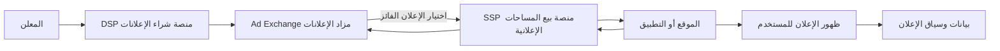
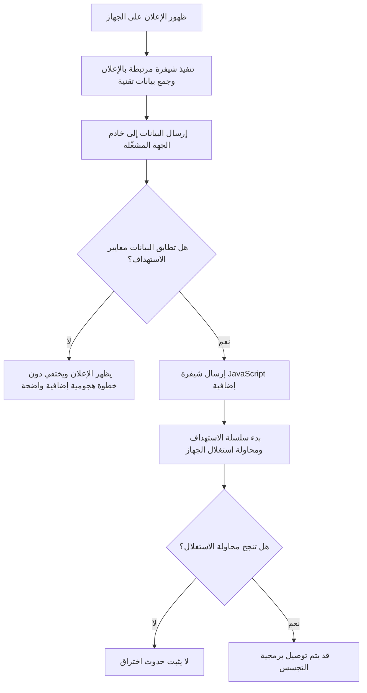
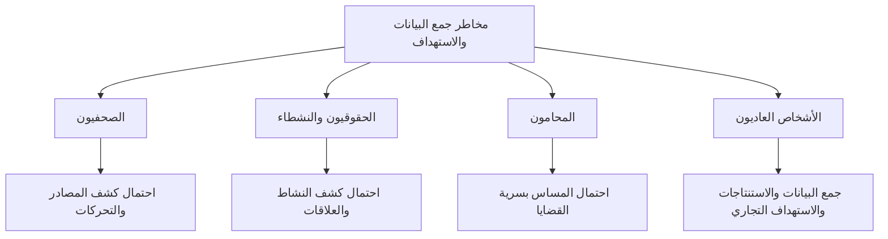
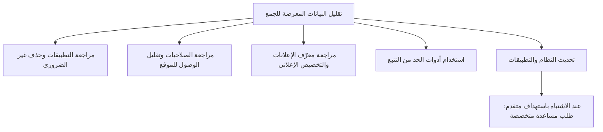

# AdFection: لما الإعلان يتحول لباب للتجسس

الإعلانات الرقمية بقت جزء من حياتنا اليومية، وبنشوفها في كل موقع وتطبيق تقريبًا. لكن ورا الإعلان اللي بيظهر على شاشة موبايلك فيه منظومة بتتعامل مع بياناتك وبتحدد مين يشوف إيه. وفي بعض الحالات، ممكن المنظومة دي تتحول من وسيلة للإعلان إلى بوابة لاستهداف الأجهزة وتوصيل برمجيات التجسس، حتى من غير ما المستخدم يضغط على الإعلان.

## شرح الإعلانات الرقمية واستخدام البيانات

في منظومة الإعلانات الرقمية، المعلومات اللي بتتجمع عن المستخدم مش دايمًا بتُستخدم لمجرد اختيار الإعلان المناسب. والمعلومات دي لو وقعت في إيد غير أمينة، ممكن تضرك. يعني لو اتعرف إن شخص بيدوّر على قروض كتير، ممكن يتم استهدافه بإعلانات عن قروض فيها مصاريف مخفية، أو حتى حملات نصب واحتيال مبنية على احتياجاته.

كمان المعلومات دي ممكن تساهم في استهدافك بالتجسس، زي ما اتذكر في تقرير Citizen Lab عن تقنية أطلقوا عليها اسم AdFection. التقرير وثّق إزاي شركة Discover-Tech الإسرائيلية استغلت بنية الإعلانات الرقمية للمساعدة في استهداف أجهزة ببرمجيات تجسس مرتبطة بشركة Candiru، وربط الباحثون الهجمات بثقة عالية بعمليات استهدفت أجهزة في شبكة الجزيرة. وفي الحالة دي، الإعلان ماكانش مجرد وسيلة لعرض منتج، لكنه استُخدم كوسيلة لتوصيل برمجيات تجسس من غير ما الضحية تحتاج تضغط على الإعلان.

### مخطط مبسط لمنظومة الإعلانات الرقمية

يوضح المخطط بصورة عامة كيف تنتقل فرصة عرض الإعلان بين المعلن والمنصات والموقع أو التطبيق الذي يعرضه.

## Discover-Tech

سنة ٢٠٢٠، أسس Dekel Boni شركة Discover-Tech كشركة إعلانات ودعاية رقمية، وظهر Yaniv Basil وGuy Lants ضمن المساهمين فيها في أبريل من نفس العام. وبعدها بشهرين، انضم Eric Banoun إلى مجلس إدارتها، واللي وصفته جريدة هآرتس الإسرائيلية كأحد رواد السيبرانية الهجومية الإسرائيلية. ولم تظهر الشركة من فراغ، بل استفادت من أصول وخبرات شركات سابقة، مثل شركة Matomy التي أطلقت تقنية MyDSP سنة ٢٠١٦، قبل ما تبيعها إلى شركة Marketcom Technologies سنة ٢٠١٨. وبعدها انتقلت السيطرة على نطاقات MyDSP الرئيسية إلى Discover-Tech في سنة ٢٠٢٠، لكن تفاصيل انتقالها بالضبط ما زالت غير واضحة. أما Controlium، فظهرت كأداة أو منصة تابعة لـ Discover-Tech، وهي تتيح للمستخدمين إعداد حملات إعلانية والتحكم في استهداف أجهزة أو أشخاص محددين باستخدام معرّفات رقمية.

## آلية الهجوم

طيب إزاي كل ده؟ شرحنا إزاي الإعلانات بتشتغل، لكن إزاي تم استخدامها بشكل إجرامي؟

دلوقتي الإعلان ظهر، ودي الخطوة الأولى. وزي ما شرحنا، هو مش مجرد صورة عادية، ممكن يكون جواه أوامر برمجية بتتنفذ في الخلفية عشان تبعت معلومات تخص الشخص أو الجهاز اللي ظهر له الإعلان لخادم الجهة المشغّلة. والجهة دي، بناءً على معايير الاستهداف اللي عندها، بتقرر الخطوة الجاية تحصل ولا لأ. أغلب الناس هيظهر لهم الإعلان ويختفي من غير ما يحصل شيء واضح، وممكن كمان من غير ما يلاحظوه أصلًا. لكن لما البيانات اللي وصلت تطابق معايير الاستهداف، الخادم ممكن يرسل شيفرة JavaScript إضافية تبدأ سلسلة استهداف ومحاولة استغلال الجهاز. يعني الإعلان نفسه مش بالضرورة هو برمجية التجسس، لكنه ممكن يكون البوابة اللي بتوصل الجهاز إلى سلسلة الهجوم، من غير ما الضحية تحتاج تضغط عليه. وده اللي وثّقه Citizen Lab في حالة قناة الجزيرة. فريق التقنية في القناة رصد أنشطة غير معتادة على أجهزة بعض الصحفيين خلال ٢٠٢٤، واستمر النشاط خلال ٢٠٢٥. وبعد تحليل سجلات الشبكة، ربط الباحثون بدرجة ثقة عالية سلسلة الهجمات ببرمجية تجسس تابعة لـ Candiru، تم توصيلها عبر إعلانات من Discover-Tech. وذكر التقرير إن ما لا يقل عن ٤٥ جهازًا داخل شبكة الجزيرة استُهدف في الهجمات دي. لكن لازم نفرّق بين الأجهزة المستهدفة والأجهزة اللي ثبت اختراقها؛ لأن رقم ٤٥ في الصياغة التفصيلية لتقرير Citizen Lab يشير إلى الأجهزة المستهدفة، رغم إن الباحثين وثّقوا أدلة على إصابات فعلية ببرمجية التجسس كمان.

### مخطط مبسط لمسار هجوم AdFection

## طيب مين الأكثر عرضة للخطر؟

طبعًا مش كل الناس زي بعض، ومش كل شخص اتجمعت بياناته بيتم التجسس عليه.

لكن فيه فئات أكثر عرضة للخطر بسبب طبيعة عملها أو نشاطها، زي الصحفيين، لأن كشف تحركاتهم أو الأشخاص اللي بيقابلوهم ممكن يفضح مصادر معلوماتهم، ويسهّل مراقبتهم، وده ممكن يعود بالضرر عليهم وعلى مصادرهم.

كمان الحقوقيين والنشطاء، خاصة لو فيه تضييق على مجال العمل العام أو محاولات لإسكات النشاط ده. وكمان المحامين، لأن كشف تحركاتهم أو علاقاتهم المهنية ممكن يهدد سرية بعض القضايا أو يكشف معلومات حساسة مرتبطة بيها.

طيب الشخص العادي ملوش علاقة بده؟

يؤسفني أقولك لأ، لأن الشخص العادي ممكن تتجمع بياناته من مصادر مختلفة، وتتستخدم لأغراض تجارية بطرق مش بالضرورة تكون في مصلحته.

خلينا نفترض إنك مريت بضائقة مالية وبدأت تبحث عن قروض. بعد فترة، تلاقي إعلانات لقروض سريعة بتظهر لك في أماكن مختلفة. ده مش دليل إن الشركات عرفت ظروفك المالية بالتحديد، لكن تجميع بيانات من مصادر مختلفة ممكن يساعد على استنتاج اهتماماتك أو ظروف محتملة بتمر بيها، وتوجيه إعلانات مناسبة ليك، خصوصًا في وقت تكون فيه تحت ضغط ومحتاج حل بسرعة.

ولك أن تتخيل لو فيه جهة بتجمع بيانات من أكتر من مصدر، ممكن تستنتج عنك إيه، وتستخدم المعلومات دي إزاي؟

وفي النهاية، خصوصيتك شيء غير قابل للتفاوض، زيها زي حريتك وكرامتك، فلازم تحافظ عليها. ومش شرط تكون مشهور أو مؤثر عشان تهتم بخصوصيتك.

### مين ممكن يكون أكثر عرضة للاستهداف؟

## طيب إزاي أحمي نفسي؟

الموضوع هنا صعب، لأننا مش هنقدر نشيل الإعلانات من بنية الإنترنت أو نمنع تجميع أي بيانات، لكن فيه خطوات بسيطة تقدر تساعد في تقليل كمية البيانات اللي بتتجمع عنك.

أولًا، إيه التطبيقات اللي عندك؟ وهل هي موثوقة ولا لأ؟ وهل إنت محتاجها أصلًا؟ لو لأ، يبقى الأفضل تشيل التطبيق، خصوصًا لو مش عارف بيجمع بيانات إيه أو بيطلب صلاحيات مش محتاجها.

ثانيًا، إيه الصلاحيات اللي التطبيقات اللي عندك واخداها؟ هل تطبيق معين فعلًا محتاج القدرة على الوصول لموقعك طول الوقت؟ هنا اختيار Allow While Using the App، يعني السماح أثناء استخدام التطبيق، بيكون اختيار مفيد لما يكون مناسب لوظيفة التطبيق.

ثالثًا، استخدم أدوات مساعدة للحفاظ على الخصوصية، زي إضافة Privacy Badger من مؤسسة EFF، اللي بتساعد في حجب بعض أدوات التتبع التابعة لأطراف ثالثة أثناء تصفح الإنترنت. لكن لازم تعرف إنها مش بتحميك من كل أنواع التتبع، ومش بالضرورة تمنع جمع البيانات داخل التطبيقات نفسها.

رابعًا، راجع إعدادات معرّف الإعلانات والتخصيص الإعلاني على موبايلك وحساباتك. على بعض أجهزة أندرويد، تقدر من إعدادات الإعلانات تحذف معرّف الإعلانات أو تعيد ضبطه، وكمان تراجع خيارات الإعلانات المخصصة. أما على iPhone، فتقدر تراجع صلاحيات تتبّع التطبيقات من إعدادات الخصوصية والأمان، وتوقف الإعلانات المخصصة اللي بتقدمها Apple لو حابب. أسماء الخيارات ومكانها ممكن يختلفوا حسب إصدار النظام. والخطوات دي بتساعد في تقليل بعض أشكال التتبع والتخصيص الإعلاني، لكنها مش معناها إن كل جمع البيانات هيتوقف.

خامسًا، حافظ على تحديث نظام التشغيل والمتصفح والتطبيقات، لأن التحديثات ممكن تعالج ثغرات أمنية بيتم استغلالها في الهجمات الإلكترونية.

لكن مهم نفرّق هنا بين تقليل التتبع عمومًا والحماية من هجوم تجسس متقدم. الخطوات السابقة بتساعد على تقليل البيانات اللي بتتجمع عنك، وتحسين مستوى أمان جهازك، لكنها مش ضمان ضد برمجيات التجسس المتقدمة، خصوصًا الهجمات الموجّهة اللي ممكن تستغل ثغرات أمنية معقدة. ولو كنت شخصًا معرضًا للاستهداف أو عندك مؤشرات جدية إن جهازك اتعرض لهجوم من النوع ده، فالأفضل تستعين بمتخصص أو جهة موثوقة عندها خبرة في تحليل الأجهزة، لأن أدوات الحماية العامة وحدها ممكن ما تكونش كفاية.

وحماية الخصوصية مسؤولية مشتركة. المستخدم يقدر يقلل البيانات اللي بيشاركها، لكن الشركات مطالبة بالشفافية، والجهات التنظيمية مطالبة بمحاسبة من يسيء استخدام البيانات.

الخصوصية مش معناها إننا نختفي من العالم الرقمي، لكنها تبدأ من إننا نفهم إيه اللي بنشاركه، ومين ممكن يستفيد منه، ونطالب بحقنا في معرفة ده ومحاسبة من يسيء استخدامه.

### خطوات الحماية في لمحة

## المصادر

- [Citizen Lab: How Discover-Tech Turned Targeted Ads into a Pipeline for Spyware](https://citizenlab.ca/research/how-discover-tech-turned-targeted-ads-into-a-pipeline-for-spyware/)
- [Citizen Lab: Exposing AdFection — Executive Summary](https://citizenlab.ca/research/exposing-adfection-executive-summary/)
- [Committee to Protect Journalists: How Mass Surveillance from Online Advertising Puts Journalists at Risk](https://cpj.org/special-reports/how-mass-surveillance-from-online-advertising-puts-journalists-at-risk/)
- [Committee to Protect Journalists: Protecting Against Advertising Technology](https://cpj.org/2026/08/protecting-against-advertising-technology/)
